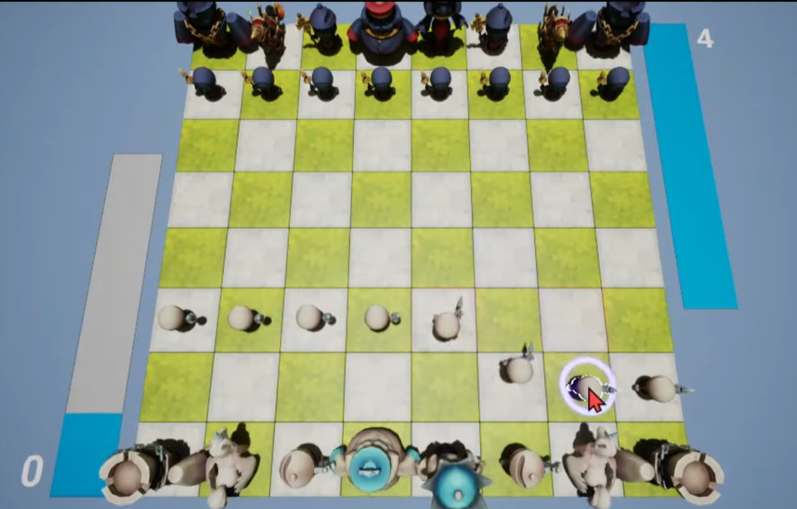
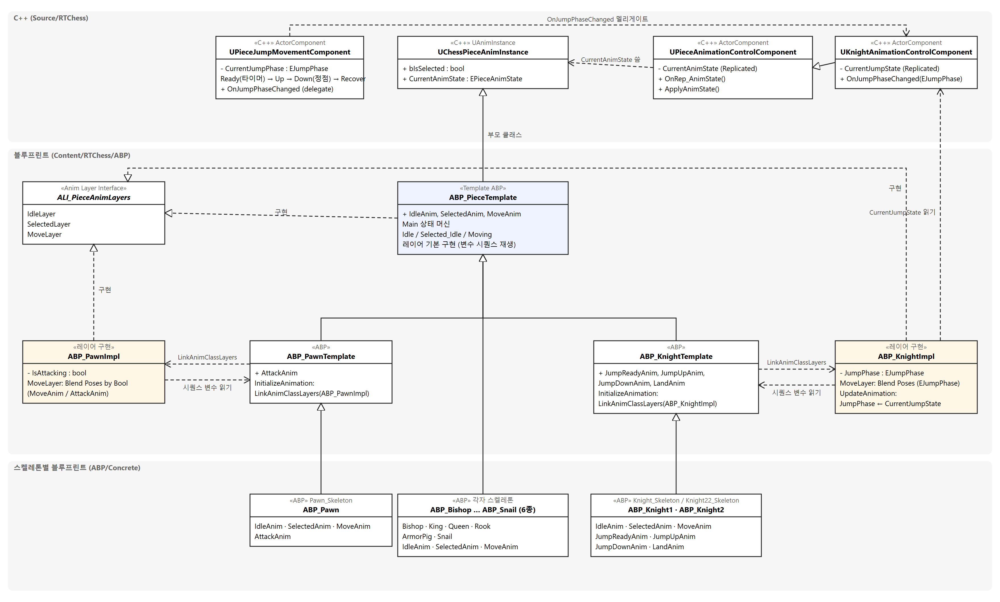
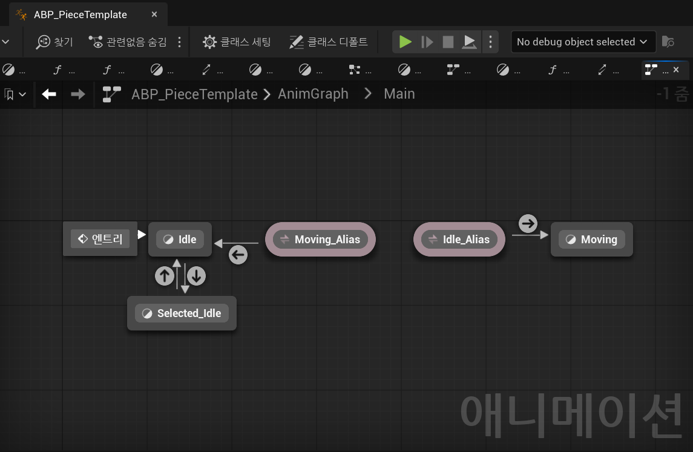
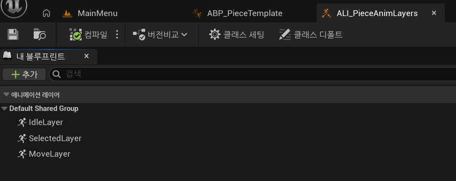
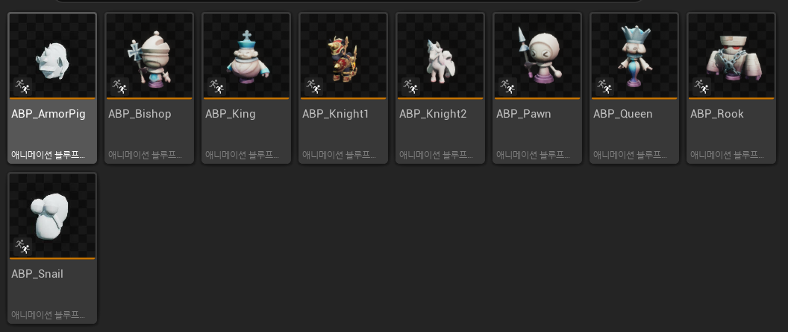
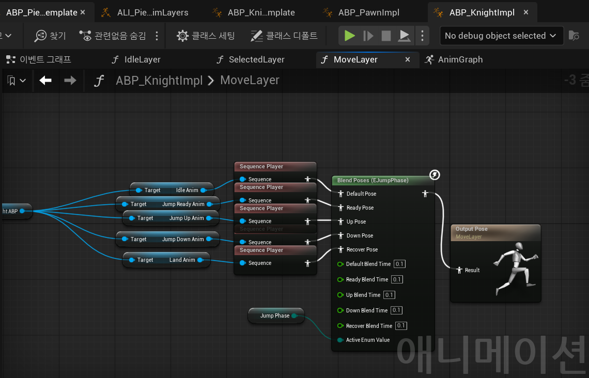
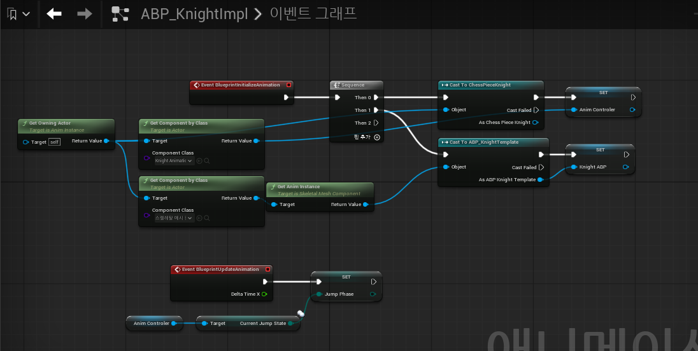

## 배경



RTChess는 기력이 차는 대로 언제든 기물을 움직이는 실시간 체스입니다. 기물 모델은
메이플스토리2 리소스에서 가져왔는데, 비숍·킹·나이트 2종·폰·퀸·룩과 몬스터 2종까지
**9종이 각각 자기 스켈레톤을 갖고 있습니다.** 언리얼의 애니메이션 블루프린트는
타깃 스켈레톤에 묶이므로, 보통 방식대로 만들면 스켈레톤마다 블루프린트를 하나씩
두고 같은 상태 머신을 아홉 번 그려야 합니다.

정작 기물이 하는 동작은 거의 같습니다.  
대기, 선택 대기, 이동 세 가지가 공통이고,  
나이트만 준비·상승·하강·착지로 이어지는 점프가,  
폰만 공격 동작이 따로 있습니다.  
공통 부분은 한 곳에 두고 기물별 차이만 따로 두는 구조가 필요했습니다.

또한 게임이 서버 권위 구조라 애니메이션 상태도 서버에서 정해져 복제됩니다.  
그래프 평가는 각 머신에서 하되 네트워크로 오가는 정보는 작게 유지해야 했습니다.

## 구현



### 템플릿 블루프린트와 레이어 인터페이스

애니메이션 레이어 인터페이스 `ALI_PieceAnimLayers`에 `IdleLayer`·`SelectedLayer`·
`MoveLayer` 세 레이어를 선언하고, 템플릿 애니메이션 블루프린트 `ABP_PieceTemplate`이
이 인터페이스를 구현합니다. 템플릿의 부모 클래스는 C++ `UChessPieceAnimInstance`로,
선택 여부와 현재 애님 상태 두 변수만 갖습니다.




상태 머신 `Main`은 Idle·Selected_Idle·Moving 세 상태로 이루어집니다. Idle과
Selected_Idle은 선택 여부로 오가고, Idle에서 Moving으로, Moving에서 Idle로 돌아오는
전이는 상태 별칭으로 선을 정리했습니다. **각 상태가 내는 포즈는 시퀀스를 직접
지정하지 않고 레이어 노드에서 받습니다.** 템플릿은 세 레이어의 기본 구현으로
`IdleAnim`·`SelectedAnim`·`MoveAnim` 변수의 시퀀스를 재생합니다.

### 스켈레톤별 블루프린트



`Concrete` 폴더의 블루프린트 9종은 모두 템플릿의 자식입니다. 각자 스켈레톤을
지정하고 `IdleAnim`·`SelectedAnim`·`MoveAnim`에 그 스켈레톤의 시퀀스를 넣는 것이
전부이고, 그래프는 하나도 없습니다. 상태 머신을 고치면 템플릿 한 곳만 바꾸면 됩니다.
**새 기물을 추가할 때도 알맞은 템플릿을 상속받아 시퀀스만 채우면 되므로** 확장이
쉽습니다.

### 기물별 동작의 레이어 교체

나이트는 템플릿의 자식 `ABP_KnightTemplate`을 한 단계 더 둡니다. 점프 시퀀스 변수
네 개(JumpReady·JumpUp·JumpDown·Land)를 추가하고, 초기화 시점에
`LinkAnimClassLayers`로 `ABP_KnightImpl`을 링크하는 것이 이 블루프린트가 하는
일의 전부입니다. 나이트 스켈레톤 2종의 블루프린트는 이것의 자식입니다.



`ABP_KnightImpl`은 같은 인터페이스를 구현하는 레이어 블루프린트입니다. `MoveLayer`가
소유 블루프린트의 시퀀스 변수 다섯 개를 프로퍼티 액세스로 읽어 Sequence Player에
물리고, `Blend Poses (EJumpPhase)`로 기본·준비·상승·하강·착지 포즈를 블렌드 시간
0.1초로 섞습니다. 어느 시퀀스를 트는지는 소유 블루프린트가 정하므로, 레이어
그래프 자체는 스켈레톤을 모른 채 나이트 2종에 공유됩니다.



점프 단계는 소유 액터의 `UKnightAnimationControlComponent`에서 읽습니다. 초기화 때
컴포넌트를 잡아 두고 `BlueprintUpdateAnimation`마다 `CurrentJumpState`를 `Jump Phase`
변수에 옮겨 적습니다. 폰의 공격도 같은 방식으로 `ABP_PawnTemplate`과
`ABP_PawnImpl` 한 쌍을 붙였습니다.

### C++ 애님 제어 컴포넌트

블루프린트가 읽는 값은 전부 C++ 컴포넌트가 갖습니다. `UPieceAnimationControlComponent`는
선택 컴포넌트·이동 컴포넌트·이동 명령의 델리게이트를 받아 `CurrentAnimState`를
바꾸고, 이 값은 `Replicated`라 클라이언트에는 `OnRep`으로 도착해 애님 인스턴스
변수에 옮겨집니다. 나이트용 파생 컴포넌트는 점프 이동 컴포넌트의 델리게이트를
받아 `CurrentJumpState`를 같은 방식으로 복제합니다.

```cpp
// 서버에서 바뀐 애님 상태가 복제되면 애님 인스턴스 변수에만 옮겨 적습니다
void UPieceAnimationControlComponent::OnRep_AnimState() { ApplyAnimState(); }
void UPieceAnimationControlComponent::ApplyAnimState()
{
    if (!IsValid(AnimInstance)) return;
    AnimInstance->CurrentAnimState = CurrentAnimState;
    OnAnimStateChanged.Broadcast(CurrentAnimState);
}
```

점프 단계 자체는 `UPieceJumpMovementComponent`가 정합니다. 이동 명령을 받으면 준비
단계로 들어가 `JumpReadyTime` 타이머가 끝날 때 상승으로 넘어가고, 액터가 정점
높이에 닿으면 하강, 목표에 도착하면 회복 단계를 거쳐 타이머로 없음 상태로
돌아갑니다. 애니메이션 블루프린트는 이 단계를 읽기만 하고 되돌려 주는 것이 없습니다.

## 장단점

- **장점** — 상태 머신이 한 곳에만 있습니다. 스켈레톤별 블루프린트 9개에는 그래프가
  없고 시퀀스 변수만 있어서, 공통 동작을 고칠 때 템플릿 하나만 건드립니다.
- **장점** — 기물 종류를 추가하는 비용이 템플릿·레이어 구현체 한 쌍입니다.
- **장점** — 네트워크로 오가는 애니메이션 정보가 열거형 두 개(`CurrentAnimState`,
  `CurrentJumpState`)뿐입니다. 그래프 평가는 각 머신이 로컬에서 합니다.
- **단점** — 레이어 구현체가 특정 클래스에 묶여 있습니다. `ABP_KnightImpl`의 이벤트
  그래프가 `ChessPieceKnight`와 `ABP_KnightTemplate`으로 캐스트해서 컴포넌트를
  잡기 때문에, 그래프 쪽은 스켈레톤을 몰라도 이벤트 그래프 쪽은 나이트 전용입니다.
  인터페이스로 나눈 의미가 여기서는 살지 않습니다.
- **단점** — 점프 단계를 매 갱신마다 컴포넌트에서 읽어 복사합니다. 단계가 바뀌는
  순간에 한 번 밀어 넣는 구조가 아니라 `BlueprintUpdateAnimation`에서 계속
  폴링하는 구조입니다.

## 대안 비교

### 기물별 상태 머신 상속과 레이어 교체

레이어 인터페이스와 템플릿은 1월 첫 커밋부터 있었지만, 나이트 점프를 처음 붙일 때는
`ABP_KnightTemplate` 안에 상태 머신을 따로 그렸습니다. 두 달 뒤 폰 공격을 붙이면서
같은 구조를 한 벌 더 만들어야 하는 상황이 되자 레이어 교체 방식으로 재편했습니다.

| | 기물별 상태 머신 (2월) | 레이어 교체 (3월, 선택) |
|---|---|---|
| 상태 머신 | 템플릿의 Main과 별개로 `ABP_KnightTemplate`에 Idle·Selected_Idle·Moving을 다시 그리고 JumpReady → JumpUp → JumpDown → Land 상태를 추가 | 템플릿의 Main 하나. 나이트는 `MoveLayer` 구현체만 교체 |
| 점프 단계 전달 | C++ `UKnightAnimInstance` 파생 클래스에 `CurrentJumpState`를 두고 컴포넌트가 씀 | 파생 애님 인스턴스 없음. 레이어 블루프린트가 컴포넌트 값을 읽음 |
| 기물 종류 추가 | 상태 머신 한 벌과 애님 인스턴스 파생 클래스 한 개 | 템플릿·레이어 구현체 한 쌍 |
| 공통 동작 수정 | 템플릿과 나이트 두 곳 | 템플릿 한 곳 |

버린 이유는 중복입니다. 공통 상태 세 개가 나이트 쪽에 한 번 더 있어 템플릿을 고치면
나이트도 따라 고쳐야 했고, 폰까지 같은 방식으로 가면 세 곳이 됩니다. 재편하면서
공격을 애님 상태에서 빼고 이동의 한 종류(`EMoveType`)로 옮겨, 상태 머신에 공격
상태를 추가하는 대신 폰의 `MoveLayer`가 `IsAttacking` 값으로 이동·공격 시퀀스를
고르게 했습니다.
