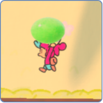
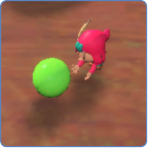
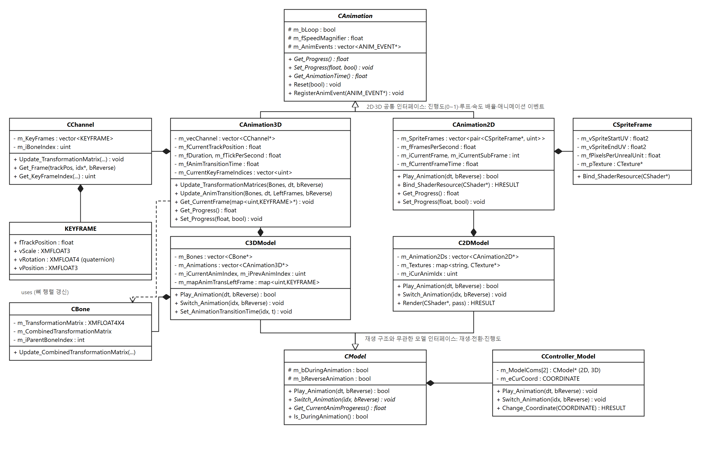
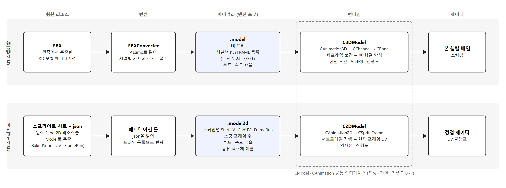
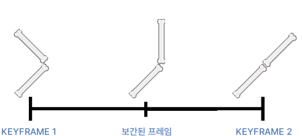
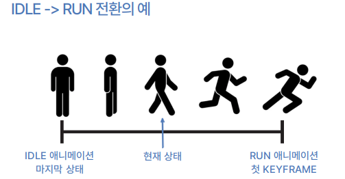
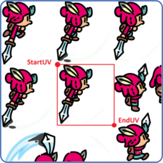
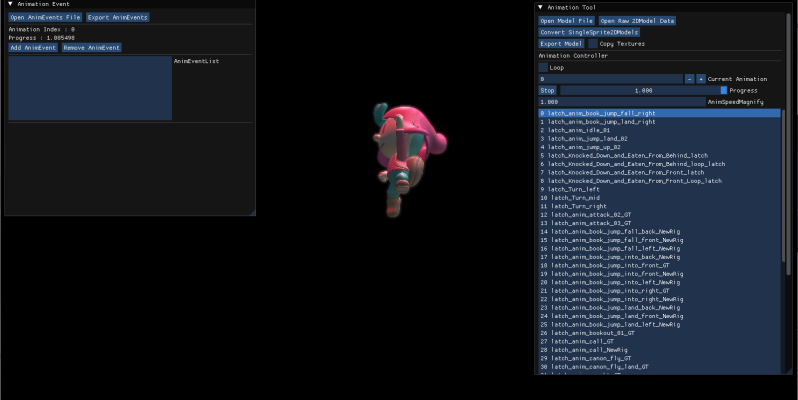

## 배경

견습 기사 모험기 모작은 7인 팀이 자체 DirectX11 엔진 위에서 만든 프로젝트였고,
저는 애니메이션과 플레이어를 담당했습니다. 엔진에 애니메이션 재생 경로가 없는
상태에서 시작했기 때문에, 원본 리소스를 바이너리로 굽는 컨버터부터 런타임 재생,
확인용 툴까지 애니메이션 파이프라인 전체를 제가 만들었습니다.

원작은 **2D 그림책과 3D 세계를 오가는 게임**이라 플레이어부터가 2D 스프라이트 모델과
3D 스켈레탈 모델을 둘 다 갖고 있었고, 둘은 재생 구조가 완전히 다릅니다. 3D는
뼈마다 키프레임을 보간해 행렬을 만들고, 2D는 스프라이트 시트에서 프레임을 골라
찍습니다. **재생 구조가 다른 두 애니메이션을 게임 로직이 같은 방식으로 다룰 수
있어야 한다는 것이 이 시스템의 핵심 요구였습니다.**




3D 스켈레탈 애니메이션의 키프레임을 읽어 뼈 행렬을 갱신하는 기본 재생 구조는
학원 커리큘럼의 기본 틀을 참고해서 작성했습니다. 그 위에 얹은 애니메이션 전환
보간, 역재생, 0~1 진행도, 루프·속도 배율의 바이너리화, 2D 스프라이트 애니메이션,
애니메이션 이벤트 연동, 툴은 제가 단독으로 구현했습니다. 애니메이션 클래스의
커밋은 전부 제 계정이고, 팀원 커밋은 형 변환·텍스처 참조 카운트 같은 소규모
수정입니다.

요구된 것은 다음과 같습니다.

- 3D — 키프레임 정보를 기반으로 재생하고, 전환 시 두 애니메이션이 부드럽게
  보간돼야 합니다.
- 2D — 프레임 시간과 스프라이트 시트 분할 정보를 기반으로 재생해야 합니다.
- 공통 — 거꾸로 재생할 수 있고, 재생 속도를 조절할 수 있고, 진행도를 0~1 값으로
  알 수 있어야 합니다.

## 구현

### 공통 구조

재생 방식과 무관한 것은 두 추상 클래스에 모았습니다. `CAnimation`은 애니메이션
한 개의 **진행도·루프 여부·속도 배율·이벤트 목록**을 갖고, `CModel`은 모델 한 개의
재생·전환·현재 진행도 인터페이스를 갖습니다. 3D의 `CAnimation3D`·`C3DModel`과
2D의 `CAnimation2D`·`C2DModel`이 각각 이것을 상속합니다.



진행도는 두 쪽 모두 0~1로 정규화해 돌려줍니다. 3D는 트랙 위치를 애니메이션
길이로 나누고, 2D는 지나온 서브프레임 수를 전체 서브프레임 수로 나눕니다. 게임
로직은 이 값만 보기 때문에 재생 구조를 몰라도 되고, 이 진행도 위에 올라간
애니메이션 이벤트 시스템은 별도 사례(`anim-event-system`)로 적었습니다.

플레이어처럼 두 모델을 다 가진 오브젝트는 `CController_Model`이 2D·3D 모델을
하나씩 들고, 현재 좌표계에 맞는 쪽으로 재생·전환·종료 콜백을 넘깁니다.
게임 로직은 컨트롤러에 `Switch_Animation`을 호출할 뿐, 지금 2D인지 3D인지
분기하지 않습니다.

### 데이터 경로

두 쪽 다 원본을 런타임에서 직접 읽지 않고 엔진 포맷 바이너리로 한 번 굽습니다.
3D는 별도 프로젝트 `FBXConverter`가 FBX를 Assimp로 읽어 뼈 트리와 채널별
`KEYFRAME` 목록을 `.model`로 쓰고, 2D는 애니메이션 툴이 원작(Paper2D)에서
FModel로 추출한 스프라이트 시트와 json을 읽어 프레임별 UV 영역과 `FrameRun`을
`.model2d`로 씁니다. 루프 여부와 속도 배율은 두 포맷 모두에 들어가서, 툴에서
정한 값이 클라이언트에 그대로 적용됩니다.



런타임에서 3D는 `CChannel`(뼈 하나의 키프레임) → `CAnimation3D`(채널 묶음과 트랙
위치) → `CBone`(부모 인덱스로 합성 행렬) 순으로 뼈 행렬 배열을 만들어 스키닝
셰이더에 넘기고, 2D는 `CAnimation2D`가 현재 프레임의 `CSpriteFrame`을 골라 그
`StartUV`·`EndUV`를 정점 셰이더에 넘깁니다.

### 3D — 키프레임 탐색과 보간

채널은 트랙 위치를 감싸는 두 키프레임을 찾아 크기·위치는 선형 보간, 회전은
구면 선형 보간으로 섞습니다.



키프레임 탐색은 매번 처음부터 훑지 않고 채널마다 직전 인덱스를 캐시해 두고
거기서 앞으로(역재생이면 뒤로) 한 칸씩 옮깁니다. `Set_Progress`로 재생 위치를
임의로 옮기면 캐시가 어긋나므로, 그때만 `Update_CurrentKeyFrameIndices`로 전
채널의 인덱스를 다시 맞춥니다.

### 3D — 애니메이션 전환 보간

전환은 두 애니메이션을 동시에 진행시키지 않습니다. `Switch_Animation`이
호출되는 순간 이전 애니메이션의 현재 포즈를 뼈별 `KEYFRAME` 스냅샷으로 저장하고,
전환 시간 동안 그 스냅샷과 새 애니메이션의 첫 키프레임 사이를 보간합니다.
전환 시간이 지나면 새 애니메이션이 처음부터 정상 재생됩니다.



```cpp
// Switch_Animation: 이전 애니메이션의 현재 포즈를 뼈별 KEYFRAME으로 스냅샷
m_Animations[m_iPrevAnimIndex]->Get_CurrentFrame(&m_mapAnimTransLeftFrame);

// 전환 구간의 매 프레임: 스냅샷 -> 새 애니메이션 첫 키프레임 보간
bool CAnimation3D::Update_AnimTransition(const vector<CBone*>& Bones, _float fTimeDelta,
                                         const map<_uint, KEYFRAME>& LeftFrames, _bool bReverse)
{
    m_fCurrentTrackPosition += m_fTickPerSecond * fTimeDelta * m_fSpeedMagnifier;
    _float fTransEnd = m_fAnimTransitionTime * m_fTickPerSecond;
    if (m_fCurrentTrackPosition > fTransEnd) { Reset(bReverse); return true; }   // 전환 끝

    _float fRatio = m_fCurrentTrackPosition / fTransEnd;
    for (auto& pChannel : m_vecChannel)
    {
        _uint iBone = pChannel->Get_BoneIndex();
        const KEYFRAME& tLeft = LeftFrames.count(iBone) ? LeftFrames.at(iBone) : pChannel->Get_KeyFrame(0);
        KEYFRAME tFrame = Lerp_Frame(tLeft, pChannel->Get_KeyFrame(0), fRatio);
        Bones[iBone]->Set_TransformationMatrix(ToMatrix(tFrame));
    }
    return false;
}
```

전환 시간은 애니메이션마다 따로 둡니다. 기본값은 0.1초이고, 플레이어는 회전
동작 0.35초, 도시락 포즈 2초, 회전 공격 0초처럼 17개 애니메이션에 값을 개별
지정했습니다.

### 2D — 프레임 재생과 UV 클램프

재생은 서브프레임 단위로 진행합니다. `CAnimation2D`는 초당 프레임 수의 역수만큼
시간이 쌓일 때마다 서브프레임을 하나 올리고, 현재 프레임의 `FrameRun`(그 프레임을
몇 서브프레임 동안 보여줄지)을 채우면 다음 프레임으로 넘어갑니다. 역재생은 프레임 인덱스를 감소시키는 것으로 같은
코드 안에서 처리합니다. 2D에는 전환 보간이 없어서 `Switch_Animation`은 새
애니메이션을 처음 프레임으로 되돌리는 것으로 끝납니다.



그리기는 시트를 자르지 않습니다. 시트 텍스처 하나를 모델의 프레임들이 공유하고,
매 프레임 현재 `CSpriteFrame`의 `StartUV`·`EndUV`를 셰이더에 바인딩하면 정점
셰이더가 사각형의 텍스처 좌표를 그 범위로 클램프합니다.

```hlsl
// Shader_VtxPosTex.hlsl — VS_SPRITE2D
Out.vTexcoord = clamp(In.vTexcoord, g_vSpriteStartUV, g_vSpriteEndUV);
```

### 애니메이션 툴

만든 애니메이션을 클라이언트를 띄우지 않고 확인하려고 ImGui 툴을 같이
만들었습니다. `.model`·`.model2d`를 열어 애니메이션 목록에서 골라 재생하고,
슬라이더로 진행도를 옮기고, 속도 배율과 루프 여부를 바꿔 저장합니다. FModel로
추출한 2D 리소스를 `.model2d`로 변환하는 것도 이 툴이 합니다. 툴의 사용 가이드를
Notion으로 팀에 공유했습니다.



가이드 전문 링크: [애니메이션 툴 가이드](https://silicon-humor-0e8.notion.site/183c1ed420d180919dd0e1f85a7b341e)

## 장단점

- **장점** — 게임 로직이 2D·3D를 구분하지 않습니다. 진행도·루프·속도 배율·
  재생·전환이 `CAnimation`·`CModel` 인터페이스에 있어서, 플레이어처럼 두 모델을
  다 가진 오브젝트가 하나의 컨트롤러로 묶이고 애니메이션 이벤트도 같은 코드가
  두 쪽에 붙습니다.
- **장점** — 전환에 이전 애니메이션의 상태가 필요 없습니다. 스냅샷 하나만
  저장하면 되므로 어떤 애니메이션이 어느 진행도에 있든 그 자리에서 끊고 새
  애니메이션으로 넘어갈 수 있고, 전환 중에는 이전 애니메이션을 갱신하지 않습니다.
- **장점** — 2D는 스프라이트 시트를 자르지 않고 UV 범위만 바꾸므로, 프레임 수만큼
  텍스처를 만들지 않고 시트 하나를 프레임들이 공유합니다.
- **장점** — 팀원들이 직접 썼습니다. `Switch_Animation`은 클라이언트 128개
  파일에서 호출되고, 애니메이션 종료 콜백은 62개 파일에서 등록됩니다. 플레이어
  하나가 3D 애니메이션 122개를 이 시스템 위에서 재생합니다.

- **단점** — 상체·하체 같은 부분 블렌딩이 없습니다. 애니메이션 하나가 모든 뼈를
  덮기 때문에 이동하면서 상체로 다른 동작을 하는 것을 만들 수 없습니다. 개발
  중반에 이 기능이 꼭 필요하다는 것을 알게 됐지만, 대규모 리팩토링이 필요해
  보였고 남은 일과 기간을 감안해 넣지 못했습니다.
- **단점** — 전환 구간에서는 진행도가 재생 위치를 뜻하지 않습니다. 트랙 위치가
  전환 시간을 기준으로 흐르기 때문에 `Get_Progress`가 0에 가까운 값을 돌려주고,
  이 구간은 `Is_DuringAnimation`으로 이벤트 판정에서 제외해야 합니다.


## 대안 비교

### 전환 방식: 스냅샷 보간과 크로스페이드

이 시스템에서 무게가 있는 결정은 애니메이션 전환을 어떻게 보간하느냐였고,
저는 처음부터 스냅샷 보간으로 만들었습니다. 당시에는 다른 방식을 검토하지
않았습니다. 두 애니메이션을 동시에 진행시키며 가중치로 섞는 크로스페이드는 뒤에
알게 됐고, 지금 둘을 비교하면 다음과 같습니다.

| | 스냅샷 보간 (구현) | 크로스페이드 |
|---|---|---|
| 전환 중 이전 애니메이션 | 스냅샷 포즈에 정지 | 계속 진행 |
| 전환 중 새 애니메이션 | 첫 키프레임에 고정, 전환이 끝나야 0에서 시작 | 계속 진행, 전환이 끝나면 전환 시간만큼 진행된 상태 |
| 전환 중 보이는 움직임 | 정지 포즈에서 정지 포즈로 이동 | 양쪽 움직임이 유지된 채 섞임 |
| 유지해야 하는 상태 | 뼈별 `KEYFRAME` 스냅샷 하나 | 두 애니메이션의 트랙 위치 둘 다 |
| 뼈당 계산 | 보간 1회 | 키프레임 보간 2회 + 블렌드 1회 |
| 전환 중 진행도 | 정의되지 않음 | 새 애니메이션 기준으로 정의 가능 |

스냅샷 보간은 상태가 적고 어느 시점에서든 끊을 수 있다는 점이 장점이지만,
전환 구간 동안 양쪽 애니메이션이 모두 멈춘다는 것과 진행도가 비는 것은
크로스페이드에 없는 제약입니다. 지금 다시 만든다면 스냅샷 보간을 없애기보다
크로스페이드를 전환 옵션으로 추가해 둘 중 고를 수 있게 하겠습니다.

## 회고

2D/3D 애니메이션 재생 기능과, 이 둘을 0에서 1 사이의 진행도라는 개념으로 인터페이스를 통합한 것은 필요한 작업이었고, 잘 설계했다고 생각합니다.

그러나 상체·하체 분리 애니메이션 기능이 필요했음에도 프로젝트 기간 압박 때문에 구현하지 못한 것이 가장 아쉽습니다. 다시 만든다면 이
기능을 반드시 넣고 싶습니다. 또한 애니메이션 전환 방식도 크로스페이드를 옵션으로 고를 수 있게 하고 싶습니다.
